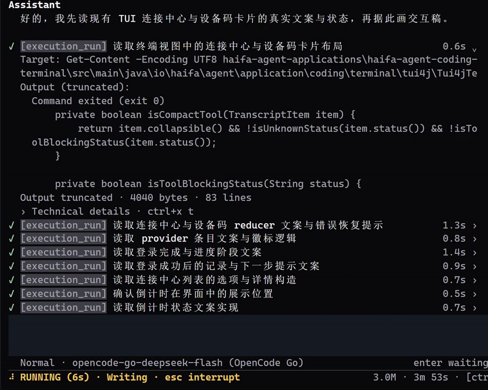

# Haifa Agent

[](https://github.com/haifa-agent/haifa-agent/actions/workflows/feature-pr-fast.yml)   

**面向 Java / Spring 生态的 Agent Runtime。**

用纯 Java 构建能调用工具、支持人工审批和暂停恢复的 AI Agent。通过 **Java SDK** 把 Agent 嵌入现有 Java / Spring Boot 应用，也可以直接使用基于同一 Runtime 的 **Coding Agent** 和 **Personal Assistant**。

[**看 Coding Agent 演示**](#coding-agent-演示) · [下载 Coding Agent](https://github.com/haifa-agent/haifa-agent/releases/latest) · [接入 Java SDK](#java-sdk-快速开始)

> 当前开发线为 `0.1.6-SNAPSHOT`，最新正式版为 `0.1.5`。已发布制品见 [GitHub Releases](https://github.com/haifa-agent/haifa-agent/releases)。
>
> 项目仍处于快速演进阶段，README 和 `docs/` 只描述当前源码已经实现的能力。

## Coding Agent 演示

看 Coding Agent 如何阅读现有实现、生成 HTML 交互稿并验证改动。演示来自实际会话回放，点击终端截图播放约 22 秒的完整片段。

[](https://haifa-portal.pages.dev/demos/coding-agent/01-coding-loop.mp4)

| 场景 | 回放里能看到什么 |
| --- | --- |
| [读代码并修改](https://haifa-portal.pages.dev/demos/coding-agent/01-coding-loop.mp4) | 阅读项目、修改文件、运行校验。 |
| [遇到失败后调整](https://haifa-portal.pages.dev/demos/coding-agent/02-failure-recovery.mp4) | 根据命令失败的原因调整做法并继续。 |
| [向用户澄清](https://haifa-portal.pages.dev/demos/coding-agent/03-clarification.mp4) | 列出选项，等待用户选择后继续。 |
| [执行前审批](https://haifa-portal.pages.dev/demos/coding-agent/05-approval.mp4) | 在工具执行前查看操作及范围，选择批准或拒绝。 |
| [验证并报告](https://haifa-portal.pages.dev/demos/coding-agent/04-verify-and-report.mp4) | 运行构建，说明验证结果、遇到的阻碍和后续步骤。 |

[在 Haifa Portal 中观看五段回放](https://haifa-portal.pages.dev/zh-cn/agent/)

### 在自己的项目里试用

Windows x64 用户可以下载 [Coding Agent 便携包](https://github.com/haifa-agent/haifa-agent/releases/latest)。解压后运行 `bin/install.bat`，重新打开终端，在项目目录输入 `haifa`，首次使用按提示配置模型。Coding Agent 默认使用当前目录作为工作区。

[一键安装指南](docs/get-started/installation.md#coding-agent)面向 Windows x64 和 Ubuntu 24.04 / WSL2 x64。一键安装命令随首个带安装脚本的正式版提供。macOS 和源码开发环境可使用[本地发行目录](haifa-agent-applications/haifa-agent-cli/README.md#构建与运行)。

## Java SDK 快速开始

Coding Agent 的工具执行、人工审批和任务状态由 Haifa Agent Runtime 协调。Java 21 应用可以通过纯 Java Starter 接入同一 Runtime，Spring Boot 应用可以用 [Spring Boot Starter](docs/get-started/spring-boot.md) 装配 Agent 和工具 Bean。

使用 JDK 21 和 Maven 3.9+，也可以使用仓库自带的 Maven Wrapper。从 [GitHub Releases](https://github.com/haifa-agent/haifa-agent/releases/latest) 下载 SDK ZIP。将解压后的 `repository/` 配置为 Maven 文件仓库，再导入对应版本的 BOM 和 Starter。 [安装与 Maven 配置](docs/get-started/installation.md#java-sdk)

设置 `DEEPSEEK_API_KEY` 后，运行以下代码发起一次真实模型调用。默认模型是 DeepSeek V4 Flash。

```java
import io.haifa.agent.starter.HaifaAgentStarter;

public class HelloHaifa {
    public static void main(String[] args) throws Exception {
        try (var agent = HaifaAgentStarter.create()) {
            System.out.println(agent.chat("用一句话介绍 Haifa Agent").await().text());
        }
    }
}
```

Starter 默认在进程内保存状态。要体验跨进程恢复，按 [SQLite 持久化示例](haifa-agent-applications/haifa-agent-sdk-example/src/main/java/io/haifa/example/sdk/advanced/SqliteDurableReferenceAssemblyExample.java) 装配持久化。

可以先用本地 Stub 模型试跑，无需 API Key。[天气查询示例](haifa-agent-applications/haifa-agent-sdk-example/src/main/java/io/haifa/example/sdk/intermediate/TypedJavaToolExample.java) 演示了「模型发起工具调用 → Java 工具返回结果 → 模型生成回答」。 [运行示例](haifa-agent-applications/haifa-agent-sdk-example/README.md)

<details>
<summary>查看 Pure Java 项目的 Maven 依赖配置</summary>

```xml
<dependencyManagement>
    <dependencies>
        <dependency>
            <groupId>io.haifa</groupId>
            <artifactId>haifa-agent-bom</artifactId>
            <version>0.1.5</version>
            <type>pom</type>
            <scope>import</scope>
        </dependency>
    </dependencies>
</dependencyManagement>

<dependencies>
    <dependency>
        <groupId>io.haifa</groupId>
        <artifactId>haifa-agent-sdk-starter</artifactId>
    </dependency>
</dependencies>
```

</details>

## Agent Loop 如何推进任务

- **模型决定下一步。** 根据任务和已有结果，模型选择调用工具、向用户提问，或给出最终结果。
- **Runtime 负责执行。** 每轮构建上下文并调用模型，检查权限和执行预算，按策略执行工具，再把结果交给模型判断下一步。 [了解 Agent Runtime](docs/core-components/agent-runtime.md)

工具调用需要**人工审批**时，Runtime 会在执行前暂停，等待用户批准或拒绝。启用持久化后，已保存暂停状态的任务可以在进程重启后**继续执行**。 [了解持久化与恢复](docs/core-components/persistence-and-recovery.md)

---

## 为什么使用 Haifa Agent

### Pure Java Core，Spring 原生友好

Core、Runtime、SDK、Tool、Memory 等核心能力保持 Pure Java。

Spring Boot 只作为 Adapter / Starter 层存在，负责 Bean、Configuration 与 Lifecycle：

```text
Your Spring Application
        │
        ▼
Spring Boot Starter
        │
        ▼
Haifa Agent SDK
        │
        ▼
Agent Runtime
```

运行 Agent 不需要额外启动一套 Python Agent Service。

### 用 Java record 定义 Tool

不需要手写一堆 JSON Schema 和参数解析代码。

```java
public record WeatherRequest(String city) {}

public record WeatherResponse(String forecast) {}

public final class WeatherTool
        implements JavaTool<WeatherRequest, WeatherResponse> {

    @Override
    public JavaToolSpec<WeatherRequest, WeatherResponse> spec() {
        return JavaToolSpec.builder(
                        "weather_get",
                        WeatherRequest.class,
                        WeatherResponse.class)
                .description("Get weather for a city")
                .pure()
                .build();
    }

    @Override
    public WeatherResponse invoke(
            WeatherRequest request,
            JavaToolContext context) {
        return new WeatherResponse("Sunny");
    }
}
```

SDK 自动完成：

```text
Java record
    ↓
JSON Schema
    ↓
Tool Catalog
    ↓
Model Tool Call
    ↓
Schema Validation
    ↓
Policy / Approval
    ↓
Java Method
```

[Java Tool Guide →](docs/advanced/tools.md)

### 原生 HITL 与安全恢复

Agent 可以在执行过程中暂停，等待：

- Clarification
- Confirmation
- Approval

这些正常 Interaction / Pause 状态可以持久化，并在进程重启后继续。

对于已经 Dispatch、但最终结果无法确认的 Side Effect，Runtime 不会冒险自动重放：

```text
Known result
    → continue

Waiting for approval
    → persist
    → restart
    → continue

Unknown side effect
    → fail closed
    → do not blindly replay
```

Haifa Agent 追求的不是“任何 Crash 都假装无缝恢复”，而是**恢复已经知道的事实，不猜测不知道的事实**。

[Persistence & Recovery →](docs/core-components/persistence-and-recovery.md)

### 多 Provider，但不偷偷降级

当前已经提供或验证的 Model Integration 包括：

- DeepSeek
- Google Gemini
- OpenAI-compatible API
- Anthropic-style API
- 多个 OpenAI-compatible Provider Binding

Run 创建时会冻结实际 Model Binding。

如果某个 Provider 或 Binding 不可用，Haifa Agent 会显式失败，而不是偷偷换一个 Model 继续运行。

[Model Providers →](docs/advanced/model-providers.md)

---

## 已经能做什么

| 能力 | 当前支持 |
| --- | --- |
| Conversation / Run | Multi-turn Conversation、异步 Run、Cancel、Resume |
| Streaming | Assistant Output Stream、Durable Run Event |
| Java Tool | Typed Java record、自动 Schema、Tool Loop |
| Structured Output | Java record 作为 Final Output Contract |
| MCP | MCP Client、Tool Discovery / Import、stdio / HTTP；纯 Java 用 `McpServerSpec` 声明式接入 |
| Skill | `SKILL.md`、Progressive Disclosure、Resource Read |
| HITL | Clarification、Approval、ASK / ALLOW / DENY |
| Persistence | SQLite、Conversation / Run / Interaction State |
| Memory | Candidate、Review、Formal Memory |
| Artifact | 显式 Artifact Export 与 Metadata |
| Workspace | Authorized Directory、File Tool |
| Execution | Shell、Build、Test、git、gh |
| Web | Web Search / Fetch Integration |
| Model | DeepSeek、Gemini、OpenAI-compatible 等 |
| Spring | Spring Boot Starter、JavaTool Bean 自动装配 |

Haifa Agent 不会因为“平台化”而默认开启全部 Capability。

产品只装配真正需要的能力。

---

## Architecture

Haifa Agent 的核心结构很简单：

```text
       Coding Agent       Personal Assistant        Your App
             \                  |                      /
              \                 |                     /
               └──────── Haifa Agent SDK ───────────┘
                              |
                              ▼
                         Agent Runtime
                              |
          ┌─────────┬─────────┼─────────┬─────────┐
          ▼         ▼         ▼         ▼         ▼
        Model      Tool      Skill     Memory    Policy
          │         │         │         │         │
          └─────────┴──────┬──┴─────────┴─────────┘
                           ▼
                       Integrations
                           |
       DeepSeek · Gemini · MCP · SQLite · Web · Host
```

三个基本原则：

1. **Core / Runtime / SDK 保持 Pure Java**
2. **Provider、Spring、SQLite、MCP 位于 Adapter / Integration 边界**
3. **Coding Agent 与 Personal Assistant 是同一个 Runtime 上的不同 Product Assembly**

不会因为某个产品需要某项功能，就自动把产品概念下沉进 Runtime。

[Architecture Overview →](docs/architecture/overview.md)

[Runtime & Module Boundaries →](docs/architecture/runtime-and-module-boundaries.md)

---

## Coding Agent

面向本地软件开发的 Terminal Agent：读取和修改代码、执行 Shell / Build / Test、使用 `git` / `gh`，并通过持续 Conversation 完成长任务。

Coding Agent 不是 SDK Demo，而是 Haifa Runtime 的实际产品之一。

它把：

```text
Model
 + File Tools
 + Shell
 + git / gh
 + Workspace
 + Skill
 + MCP
 + Policy / Approval
 + Persistence
```

组合成一个可以长期使用的 Terminal Coding Agent。

### 工具与会话能力

- File read / write / patch
- Shell / Build / Test
- `git` / `gh`
- Multi-turn Coding Session
- Workspace authorization
- Model selection
- HITL Approval
- Session persistence / resume

典型任务：

```text
> 分析这个项目为什么 Windows CI 比 Linux 慢

> 修复 failing test，并运行相关验证

> 阅读这个模块，找出 Runtime 与 Product Layer 耦合的位置

> 修改实现，但不要创建 commit
```

Model 自己负责理解任务、规划步骤和解释 Command Result。

Runtime 只负责真正应该由 Runtime 保证的事情：

- Tool Contract
- Workspace Boundary
- Approval
- Cancellation
- Budget
- Unknown Side Effect
- Lifecycle
- Persistence

[了解 Coding Agent →](docs/applications/coding-agent.md)

---

## Personal Assistant

Personal Assistant 展示了另一种完全不同的 Product Assembly。

它重点组合：

```text
Conversation
 + Model Selection
 + Tool / Skill / MCP
 + Memory
 + Web
 + Mission
 + Deep Research
 + Artifact
 + Local Web UI
```

PA 使用本地 Spring Boot Server + React Web，并默认运行在 Loopback Trusted-local 环境。

它不是一个面向公网、多租户的通用 Agent Server。

<details>
<summary>界面示意与功能列表</summary>

本地 Web Assistant，在同一个 Runtime 上组合 Conversation、Tool、Skill、Memory、Mission 与 Deep Research。

```text
┌──────────────────────────────────────────────────────────────────────┐
│ Haifa Personal Assistant                                  DeepSeek  │
├───────────────────────┬──────────────────────────────────────────────┤
│ Conversations         │ 帮我调研最近两周 Java Agent 生态的发展     │
│                       │                                              │
│ ▸ Agent Runtime       │ Research Plan                                │
│ ▸ AI Infrastructure  │   ✓ 搜索资料                                 │
│ ▸ Weekly Research     │   ✓ 阅读来源                                 │
│                       │   ◉ 综合报告                                 │
│                       │                                              │
│ Missions              │ Sources 12 · Tool Calls 28                   │
│ ▸ Java Agent Research │                                              │
│                       │ Java Agent 生态目前主要沿着……                │
├───────────────────────┴──────────────────────────────────────────────┤
│ Ask anything...                                                     │
└──────────────────────────────────────────────────────────────────────┘
```

支持：

- Multi-turn Conversation
- 多 Model / Provider
- Tool / Skill / MCP
- Memory
- Mission
- Deep Research
- Image / Audio input
- Local Web UI
- Durable SQLite state

[查看 Personal Assistant →](docs/applications/personal-assistant.md)

</details>

---

## SDK 示例

仓库包含一组可以直接运行的 SDK Example。

```text
haifa-agent-sdk-example
├── basic
│   ├── HelloHaifa
│   ├── MultiTurnConversationExample
│   └── AgentReuseLifecycleExample
│
├── intermediate
│   ├── TypedJavaToolExample
│   ├── MultiToolCollaborationExample
│   ├── StructuredOutputExample
│   ├── MultiModelProviderExample
│   └── PromptDiagnosticsExample
│
└── advanced
    ├── ConversationManagementExample
    ├── IdempotencyAndRevisionExample
    ├── RunOutputStreamingExample
    ├── RunEventJournalExample
    ├── RunQueryControlExample
    ├── TrustedCallerExample
    ├── AssemblyDiagnosticsExample
    └── SqliteDurableReferenceAssemblyExample
```

普通 Example 默认不访问真实 Provider；当前只有 `basic.HelloHaifa` 明确使用真实 Provider，并要求 `DEEPSEEK_API_KEY`。

[SDK Examples →](haifa-agent-applications/haifa-agent-sdk-example/README.md)

---

## 当前边界

Haifa Agent 当前重点面向：

> **单机 / 本地可信环境中的 Java Agent Runtime 与产品开发。**

`0.1.5` 暂不提供：

- Distributed Worker / Control Plane
- Graph / Workflow Runtime
- Enterprise IAM / Approval Workflow
- 产品默认的 Container / gVisor / microVM Sandbox
- MCP Server Hosting
- 通用公网 Multi-tenant Agent Server

当前产品默认的 `host-guarded` Execution 提供的是受控 Host Process Execution，而不是
OS Kernel-level Isolation。SDK 另提供显式装配的 Linux `docker-aio` Provider 候选；其真实
Linux 运行与隔离证据仍为 `NOT_RUN`，不属于产品默认路径。

如果需要执行完全不可信代码，应把 Haifa Agent 放入外部 VM / Container 等安全边界。

[Security →](docs/reference/security.md)

---

## 文档

第一次使用：

- [Installation](docs/get-started/installation.md)
- [Quickstart](docs/get-started/quickstart.md)
- [Key Concepts](docs/get-started/key-concepts.md)

深入理解：

- [Agent Runtime](docs/core-components/agent-runtime.md)
- [Capabilities](docs/core-components/capabilities.md)
- [Architecture](docs/architecture/overview.md)

开发 Agent：

- [Java Tools](docs/advanced/tools.md)
- [Skills & MCP](docs/advanced/skills-and-mcp.md)
- [Structured Output](docs/advanced/structured-output.md)
- [Model Providers](docs/advanced/model-providers.md)

产品：

- [Coding Agent](docs/applications/coding-agent.md)
- [Personal Assistant](docs/applications/personal-assistant.md)

完整文档入口：

**[docs/README.md →](docs/README.md)**

---

## 构建与测试

普通测试默认不会访问真实 Model、MCP 或 Web Provider。

macOS / Linux：

```bash
# 受影响模块测试
./build-support/scripts/invoke-haifa-maven.sh --layer L2 -- \
  -pl :haifa-agent-runtime-core -am test

# 最终本地门禁
./build-support/scripts/invoke-haifa-maven.sh --layer L3 -- \
  -Pci-fast clean verify
```

Windows PowerShell：

```powershell
.\build-support\scripts\invoke-haifa-maven.ps1 --layer L2 '--' `
  -pl :haifa-agent-runtime-core -am test

.\build-support\scripts\invoke-haifa-maven.ps1 --layer L3 '--' `
  -Pci-fast clean verify
```

更完整的构建与测试规则见：

[build-support/README.md](build-support/README.md)

---

## Contributing

开始修改前，请先阅读：

- [AGENTS.md](AGENTS.md)
- 对应模块的 `README.md`
- 对应模块 `pom.xml`
- 相关 Architecture Test

功能开发使用 `feat-*` 分支并发起 Pull Request。

代码与公开文档应在同一个 PR 中同步演进。

Haifa Agent 仍处于快速发展阶段。相比提前构建大量“未来可能需要”的抽象，我们更倾向于从真实 Product、真实 Failure 和真实 Consumer 出发逐步演进。

[Design Principles →](docs/architecture/design-principles.md)
